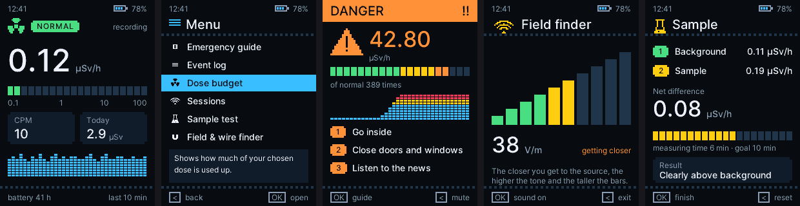

# Yarrow

Open software for Geiger counters: firmware for the FNIRSI GC-03, a BOINC monitor that reads several kinds of counters, and
a desktop app. Together they feed a live, open map of the natural background dose rate, city by city.

**Website:** [yarrow.athena.org.tr](https://yarrow.athena.org.tr) · **Live map:** [bitboinc.athena.org.tr/yarrow.php](https://bitboinc.athena.org.tr/yarrow.php) · **Data by city:** [bitboinc.athena.org.tr/yarrow_history.php](https://bitboinc.athena.org.tr/yarrow_history.php) · **Releases:** [firmware per language and Yarrow Hub](https://github.com/alplix/yarrow/releases)

## The parts

| | |
|---|---|
| **Firmware** (`src/`) | Open firmware for the FNIRSI GC-03: readable at a glance, measures honestly, logs for years. |
| **BOINC monitor** (`monitor/`) | A small program that reads a counter, cuts its pulses into exact 10-minute bins and sends them to the project as BOINC trickles. |
| **Yarrow Hub** (`hub/`) | A desktop app that works without BOINC: live dose rate, history, statistics, alarms, CSV export. |
| **Website** (`site/`) | The project page, in English and Turkish. |

## Supported counters

| Counter | Connection | Monitor | Hub |
|---|---|---|---|
| FNIRSI GC-03 with the Yarrow firmware | USB serial | yes | yes |
| Radioactive@Home USB counters (boards 2.01 to 2.60, the kit, and 3.01) | USB HID, nothing to flash | yes | yes |
| GQ GMC-300 / 320 / 500 / 600 | USB serial | yes | not yet |

Only raw pulse counts from the tube are accepted, never a rate the counter has smoothed itself. A new counter is one small
driver in `monitor/yarrow_src_*.c`; see [docs/boinc-monitor.md](docs/boinc-monitor.md).

## Join the map

1. Join [bitboinc](https://bitboinc.athena.org.tr) and attach your computer in the BOINC Manager.
2. In your project preferences select the Yarrow monitor and enter your country, city and (if you like) your detector.
3. Plug in the counter and leave the computer on. Only the city is shared, never a more exact place.

## Yarrow Hub

Download [yarrow-hub-windows-x64-setup.exe](https://github.com/alplix/yarrow/releases/latest/download/yarrow-hub-windows-x64-setup.exe).
It shows the live dose rate, keeps the history on your computer, draws statistics, shows nSv/h, µSv/h or µrem/h, rings
alarms at levels you choose and exports CSV. With a GC-03 it also sets the clock, calibrates the tube and installs
firmware. Built with Tauri (Rust and TypeScript); to build it: `cd hub/app && cargo tauri build`.

## What the firmware does

**Radiation**
- Dose rate, counts per minute, dose today, this week and in total
- An averaging window that follows the rate: long and quiet at background, quick when the rate really changes, without leaning high or low
- Tube dead-time correction
- Three alarm levels with fixed thresholds you set yourself, hysteresis, an event log and an alarm that never fires from a handful of counts
- Dose budget, sample test (background against sample), sessions for trips, walks and surveys, a calibration wizard

**Fields**
- Electric and magnetic field readings with trends
- A finder that follows wires and field sources by sound and bars

**Device**
- Battery health, remaining run time, charge cycles, a charging screen
- A log designed for years in the mountains: lossless range-coded samples, power-fail safe, within a few percent of the theoretical minimum size
- Offline emergency guide
- 21 colour themes, pixel-art decoration, a self test
- USB serial protocol for the host tools

## Install the firmware

Download the file for your language from [Releases](https://github.com/alplix/yarrow/releases) and copy it to the device in update mode. The stock bootloader is never touched, so the stock firmware can always be put back the same way. Step by step: [docs/install.md](docs/install.md).

## Build the firmware

Needs `arm-none-eabi-gcc`, GNU make and Python 3 for the build helpers.

    make                 # Turkish, build/yarrow-gc03.bin
    make YLANG=en        # English, build/en/yarrow-gc03.bin
    make release YLANG=en  # copies it to dist/yarrow-gc03-en.bin
    make check           # host tests
    make test            # runs the image in an ARM emulator
    make sim             # renders every screen to build/sim

Details in [docs/building.md](docs/building.md).

## Languages

Every language is its own firmware file, because the fonts take most of the room.

| | | | |
|---|---|---|---|
| `tr` Türkçe | `en` English | `de` Deutsch | `fr` Français |
| `es` Español | `pt` Português (Brasil) | `it` Italiano | `nl` Nederlands |
| `pl` Polski | `ru` Русский | `uk` Українська | `vi` Tiếng Việt |
| `id` Bahasa Indonesia | `zh` 简体中文 | `ja` 日本語 | `ko` 한국어 |

Adding one means copying `src/lang/en.h`, translating it and running `tools/langcheck.py`; a local model can do the first
pass: [docs/translating.md](docs/translating.md).

## Documentation

| | |
|---|---|
| [docs/install.md](docs/install.md) | putting Yarrow on the device and going back |
| [docs/usage.md](docs/usage.md) | keys, screens, alarms, sessions |
| [docs/boinc-monitor.md](docs/boinc-monitor.md) | the BOINC monitor, supported counters, server checks, credit |
| [docs/calibration.md](docs/calibration.md) | matching the readings to a reference |
| [docs/hardware.md](docs/hardware.md) | pins and memory map of the GC-03 |
| [docs/serial-protocol.md](docs/serial-protocol.md) | the USB command protocol |
| [docs/log-format.md](docs/log-format.md) | how the log is stored and compressed |
| [docs/building.md](docs/building.md) | toolchain, tests, simulator |
| [docs/translating.md](docs/translating.md) | adding a language |
| [docs/bringup.md](docs/bringup.md) | test images for a new board |

## Licence

GPL-3.0, see [LICENSE](LICENSE). The Inter font in `third_party/inter` is under the SIL Open Font License.
