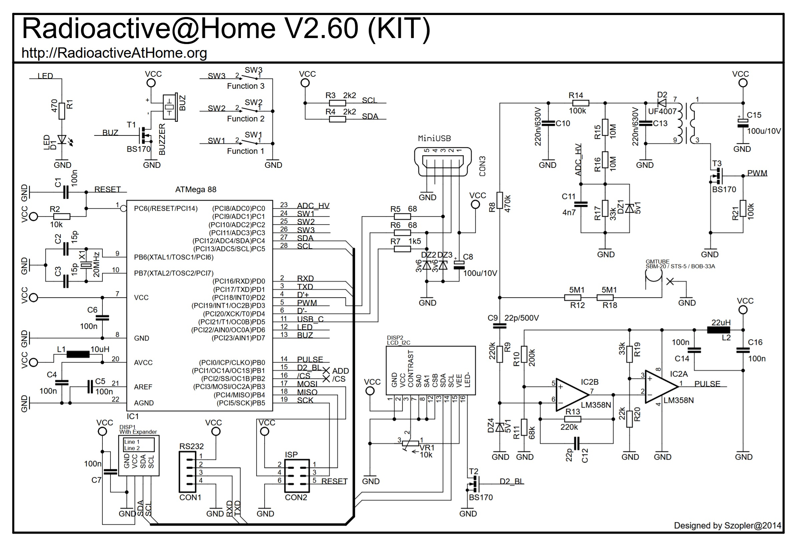

# Radioactive@Home counters

The USB counters of the old Radioactive@Home project work with the Yarrow monitor and Yarrow Hub without any change to
the counter. This page collects what is known about them. The driver is `monitor/yarrow_src_rah.c` (monitor) and
`hub/crates/yarrow-core/src/rah.rs` (Hub).

*Radioactive@Home V2.60 (KIT), designed by Szopler, 2014 (radioactiveathome.org, no longer online).*

## The boards

| Board | Chip | USB id |
|---|---|---|
| V2.01 to V2.60, the kit | ATmega88 with V-USB | `16c0:05df`, product string contains "radioactiveathome" (the kit: "Radiation Detector KIT") |
| V3.01 | Microchip PIC | `04d8:f6fe` |

The V-USB and Microchip ids are shared with unrelated devices, so the monitor and the Hub only accept them together with
the project's name in the product string and then check that the device behaves like the counter. The revision is the
USB device release number: 0x0251 is board 2.51.

## What the V2.60 schematic shows

- ATmega88 on a 20 MHz crystal; USB through the V-USB software stack on `D+` (PD2) and `D-` (PD4), 68 Ω series resistors
  and 3.6 V zener clamps, mini-USB connector.
- The Geiger-Müller tube is an SBM-20, STS-5 or BOB-33A, fed through two 5.1 MΩ resistors from a boost converter: the
  PWM output (PD3) drives a transformer through a BS170, the high voltage is divided down (two 10 MΩ and 33 kΩ) to the
  ADC input (PC0) so the firmware can regulate it.
- Each tube pulse is shaped by an LM358 comparator stage into the `PULSE` line (PB0), which the firmware counts.
- Extras on the board: three function keys, a buzzer, an LED, an I2C character display (and a header for a second one with
  a port expander), an RS232 header and an ISP header.

## What the counter reports

A HID feature report of 129 bytes: `[0]` report id, `[1..4]` the counter's own timer in milliseconds, `[5..8]` the
cumulative number of tube pulses, both 32 bit little endian. There is no clock and no stored log, so the host builds the
bins from the host clock at the bin edges and the difference of the pulse counter between them. This layout was confirmed
on a real counter (revision 2.51): the timer runs about 0.13 % slow, which the monitor allows for.

Constants used: 171.232876 counts per minute for 1 µSv/h (the factor of the project's own program) and about 190 µs of
dead time (SBM-20 data sheet).

A test program (`monitor/yarrow_rah_probe*.c`, with a window for Windows and a command-line version for Linux) prints the raw
reports and the bins the monitor would send. Ready-made builds: https://files.athena.org.tr/f/YarrowCounterTest.zip
