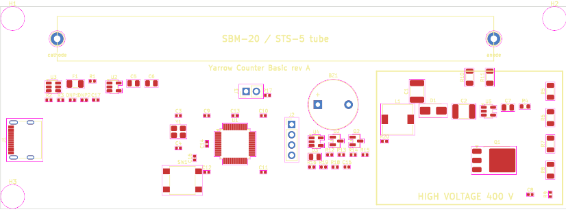

# Yarrow Counter Basic: design

The cheapest board of the family ([../README.md](../README.md)): a USB Geiger counter that counts every pulse of one
SBM-20 class tube with a microsecond time stamp and reports it over the Yarrow serial protocol. Two layers, about
140 x 35 mm, the tube sits on the board in two clips. `hv_calc.py` reproduces every number below.

## Blocks

```
USB-C ──ESD──┬── 3.3 V LDO ──┬── CH32F203C8T6 ── SWD header, BOOT0 jumper, LED, buzzer
             │               ├── comparator (pulse input)
             └── 5 V ────────┴── gate buffer ── MOSFET ── boost (L, D, C) ── 400 V ── anode resistors ── tube
```

### Power and USB

- USB-C receptacle, 5.1 kΩ on CC1 and CC2 (a plain 5 V sink), shield to ground through 1 MΩ and 4.7 nF.
- USBLC6-2SC6 on D+ and D-. The MCU's USB pins go straight to the connector (full speed, no series resistors needed
  with this part; footprints for 22 Ω in case the first spin shows ringing).
- 3.3 V from an AP2112K-3.3 (600 mA), 10 µF in and out. Load: MCU about 30 mA, comparator below 1 mA.
- A polyfuse (500 mA) in series with the USB 5 V.
- Boost input from the fused 5 V through a 10 Ω and 22 µF filter, so converter ripple stays off the logic supply.

### MCU

- CH32F203C8T6: 72 MHz Cortex-M4F class core with hardware USB, the same family as the GC-03, so the protocol and the
  clock setup of the existing firmware (8 MHz crystal, PLL to 96 MHz, USB prescaler /2) carry over.
- 8 MHz crystal, 2 x 18 pF.
- SWD header (4 pin: 3V3, SWDIO, SWCLK, GND) and a 2 pin BOOT0 jumper with a 10 kΩ pull-down, NRST button. A bad
  firmware can always be replaced.
- Pin use (checked against the alternate functions when the schematic is drawn):

| Function | Pin | Timer / peripheral |
|---|---|---|
| Pulse in | PA0 | TIM2_CH1 input capture, falling edge, 1 µs resolution |
| Boost PWM | PA8 | TIM1_CH1, 30 kHz |
| HV measure | PA1 | ADC_IN1 |
| USB | PA11 / PA12 | USB D- / D+ |
| SWD | PA13 / PA14 | |
| Buzzer | PB0 | TIM3_CH3, to the transistor |
| LED | PC13 | |

### High voltage

A boost converter in discontinuous mode, driven by the MCU:

- 1 mH inductor (saturation current above 100 mA), 600 V N-MOSFET in SOT-223 or DPAK, ES1J (600 V, 35 ns) as the
  diode, 10 nF / 630 V output capacitor.
- The MOSFET gate is driven from 5 V by a 74AHCT1G04 (its inputs accept the 3.3 V PWM, its output is a real 5 V), so
  the PWM is inverted in the timer. A 3.3 V drive would leave the MOSFET half on.
- 30 kHz; 400 V needs about 5.5 µs on-time (16 % duty, 27 mA peak) at the 70 % efficiency assumed.
- The firmware regulates the duty from the measured voltage: a divider of four 5.1 MΩ and 62 kΩ (ratio 330, 400 V reads
  1.21 V, one ADC step is 0.27 V, the divider takes 20 µA), 100 nF on the ADC pin.
- Safety in the first spin is firmware and the dog: the duty is clamped to 22 % in the timer compare range (at most
  14 mW, 535 V with no tube), the independent watchdog stops the PWM if the loop hangs, and the PWM starts only after
  the USB reports a host. Plus adds a hardware limit.
- Tube: anode through 2 x 4.7 MΩ (two 1206 resistors, so each sees half the voltage), cathode to ground. Recovery time
  constant about 90 µs with 10 pF, close to the tube's own dead time.
- Layout: the whole high-voltage part in one corner, a 3 mm slot or a keep-out around it, no signal trace under it, a
  silkscreen box with a warning. The tube clips are at the far end.

### Pulse input

A pulse of the tube pulls the anode down by 100 V or more. It is passed by a 22 pF / 1 kV C0G capacitor to a node that
rests at 1.98 V (220 kΩ to 3.3 V and 330 kΩ to ground) and is clamped by a BAV99 to ground and to 3.3 V, with 10 kΩ in
series to a TLV3201 comparator whose reference is 1.0 V. The output falls for a few microseconds per pulse and goes
to the timer input (PA0). Only the falling edge is used, so the recovery of the anode does nothing.

### Other

- Buzzer: passive piezo through a 2N7002, driven at about 4 kHz by TIM3 (clicks per pulse, off by command).
- LED on PC13 flashes per pulse (shortened above a few hundred pulses per second).
- The internal temperature sensor goes in the identity report: the first board's job is to show how the count rate and
  the voltage follow temperature.

## Board layout (placement draft)



140 x 50 mm, two layers, a ground pour on the bottom. From the left: USB-C on the edge, the 3.3 V supply, the MCU with its
decoupling at the corners, crystal and reset on its left, SWD and boot jumper, the pulse input and the buzzer, and the
high-voltage corner on the right inside a silkscreen box. The tube lies along the top strip on two clips 108 mm apart
(cathode left, anode right), so the anode resistors sit right under the anode clip and nothing high-voltage runs along the
board. The divider is a column of resistors on the right edge, 6.5 mm apart.

Rules (`kicad/yarrow_counter_basic.kicad_dru`, net classes in the project): every 400 V net (`HV`, `SW`, `ANODE`,
`ANODE_R`) keeps 2.5 mm from everything that is not high voltage (IPC-2221, 301 to 500 V, uncoated), the divider nets
1.5 mm. The leads of the MOSFET (DPAK) are 1.1 mm apart, which its 600 V rating allows but the 2.5 mm rule does not:
the rule is relaxed for Q1's own pads, and the area is to be conformally coated (IPC-2221 coated: 0.8 mm).

State: placement only, no tracks. The design rule check (`kicad/drc_report.txt`) finds no clearance, short or courtyard
violation; what remains are the 132 unrouted connections and a few silkscreen overlaps. `tools/run_pcb.sh` regenerates
the board, runs the check and renders the picture.

## What the first board must show

Measured with the board side by side with a GC-03 and a Radioactive@Home counter:

1. High voltage against the ADC reading (a high-impedance probe, 10 GΩ), the ripple, and the duty needed for 400 V:
   is the 70 % efficiency right?
2. Pulse shape at the anode and at the comparator output; is anything counted twice, is anything missed?
3. Count rate over a day against the references, and against temperature.
4. Dead time: a time-stamped pulse list lets it be read directly from the gaps.
5. USB: enumeration on Windows, Linux and a phone; ringing on D+ and D-.

The numbers go to `hardware/reports/` and into the next spin.

## Files

- `bom.csv`: the parts, values, packages, suggested part numbers.
- `netlist.md`: every net and which pins are on it.
- `hv_calc.py`: the calculations.
- `kicad/`: the KiCad 9 project. `yarrow_counter_basic.kicad_sch` is the schematic (also as `.pdf`), generated from the same
  data by `tools/make_schematic.py`; `erc_report.txt` is KiCad's electrical rules check (0 violations). Every pin carries a
  short wire and a net label, so the sheet reads like a net list and can be redrawn by hand. `tools/run_all.sh` regenerates
  the schematic, runs the check and exports the net list; `tools/check_nets.py` compares the nets that matter with the
  design. Not done yet: the routing of the PCB.
